# Dual-Bottleneck Agents（中文说明）

英文主版请见 [README.md](README.md).

论文标题：**《双重瓶颈：自进化智能体中裁判可靠度与生成器能力的组合定律》**

## 项目一句话描述

我做的方向是：当用来判断"这个任务有没有做对"的裁判本身不可靠时，一个自进化的智能体会在什么临界点上停止变好。我把它做成了一个能跑的实验，代码和数据都在这个仓库里。

The internal project codename is ARGUS; the Python package under `argus/` retains this name.

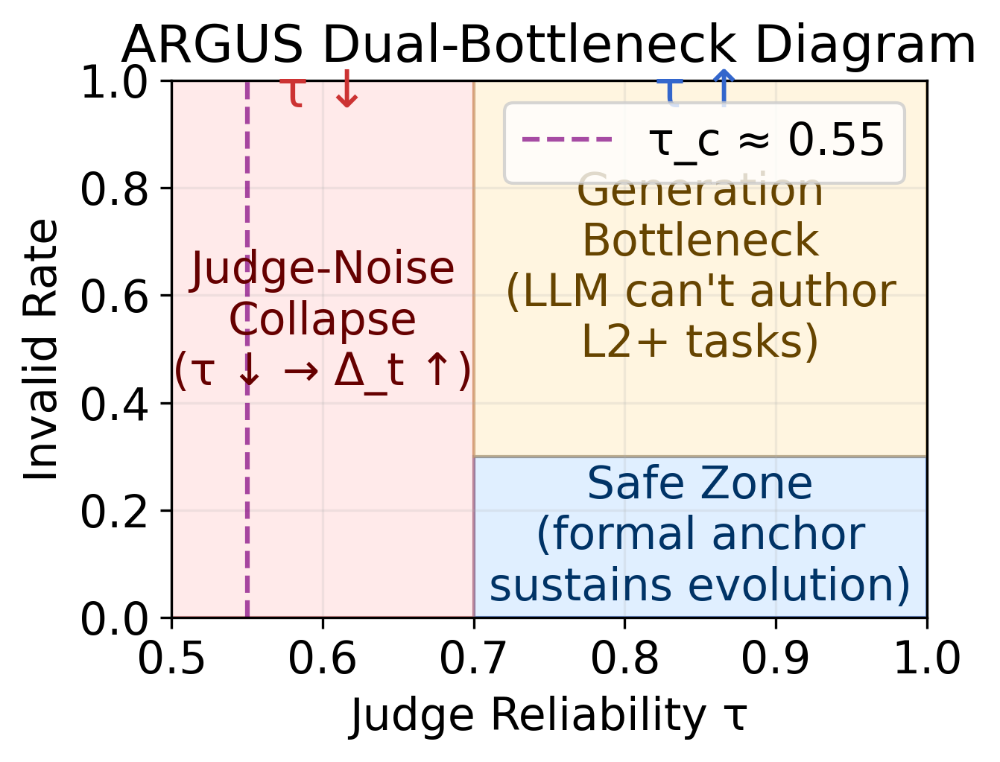

*fig1 — 只有同时满足 τ ≥ τ_c（横轴）且生成器 invalid rate ≤ 0.5（纵轴），系统才落在安全区交集内。*

## 核心发现

在 2400 轮实验里，条件 A（纯 LLM 自评）的 Δ_t 稳定在 0.15，条件 B（加 Z3 形式锚定）的 Δ_t 稳定在 0.00（B 的 0.00 是锚定的定义性结果：无效任务被拦在门外了，不是它判得更准），代价是 LLM 生成这些任务的 invalid 率很高——整体 invalid 率为 A 11.0%、B 24.5%、C 85.5%、D 90.5%，即只有启用种群博弈的 C/D 超过 80%。我进一步把裁判可靠度 τ 和评估偏差 Δ_t 的关系推成了闭式：**Δ_t(τ) = (1 − τ²)/2**，这个式子没有自由参数，实测拟合 MAE 只有 0.026（B）和 0.052（D），反推就是 **τ_c = √(1 − 2·Δ_t_max)**。我原本假设机制更复杂的 D 条件（锚定 + 种群 + 蒸馏 + 圆桌）会更脆弱、临界点应该高于 B，结果实测 τ_c(B) 和 τ_c(D) 都是 0.55——这个假设没被支持，原因我写在 [`reports/paper_ready_final.md`](reports/paper_ready_final.md) §5.8 里了。

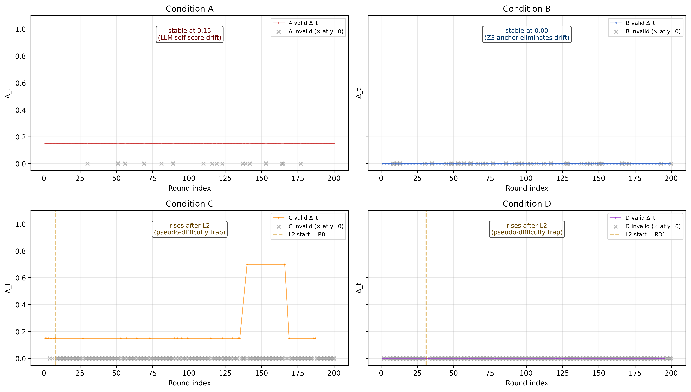

*fig2b — 逐轮 Δ_t，每格一个条件；灰色叉为无效轮，竖线是难度控制器首次升级的轮次。*

**在有效轮次口径下，Z3 锚定完全消除了自评偏差**：条件 A 稳定在 0.15，条件 B 稳定在 0.00。在全局口径下两者看起来相同（0.2435 vs 0.2450），因为条件 B 的无效轮次被记为 Δ_t = 1.0。

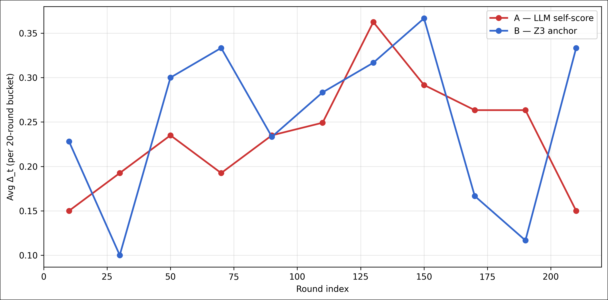

*fig2 — A 与 B 的 Δ_t 曲线（裁判侧瓶颈）。*

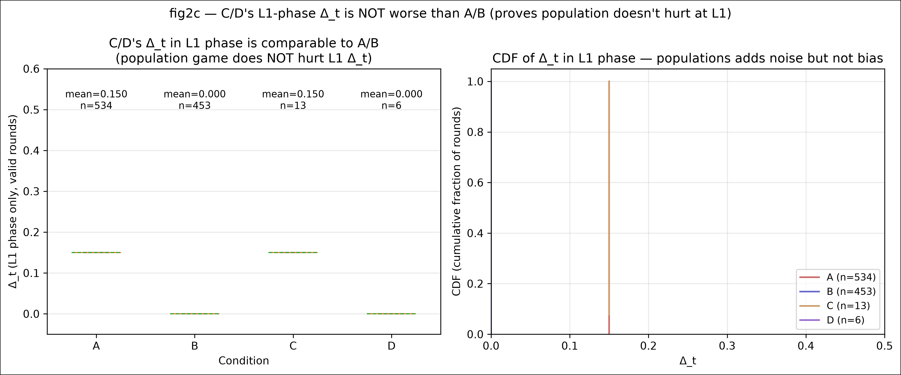

*fig2c — L1 阶段的 Δ_t。**两种口径是本项目最容易读错的地方**：`Table 2a`（全局）与 `Table 2b`（仅有效轮）对同一批轮次给出不同数字，两张表都随仓库发布，`Table 2c` 专门解释差异从哪来。*

## 伪难度陷阱

打开难度控制器（条件 C/D）之后，任务被推向 L2/L3，而教师写不出可靠的位向量与数组约束——有效任务率从 89.0%（A）/ 75.5%（B）崩到 14.5%（C）/ 9.5%（D）。

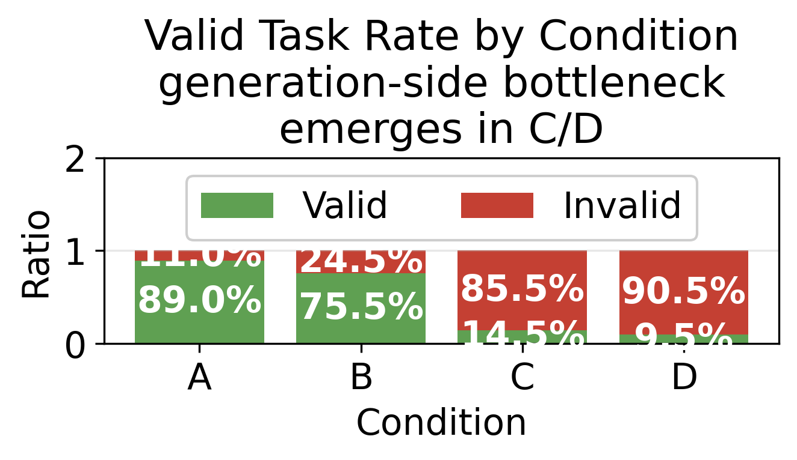

*fig3 — 按条件的有效 / 无效占比，这是"崩溃"最直接的证据。*

失效不是按难度均匀分布的，而是**聚在升级那一刻**：级别一旦被抬高，教师持续失败，控制器却把级别维持在高位。系统以为自己正在解更难的题，实际把预算烧在了无法解析或不可满足的任务提案上。

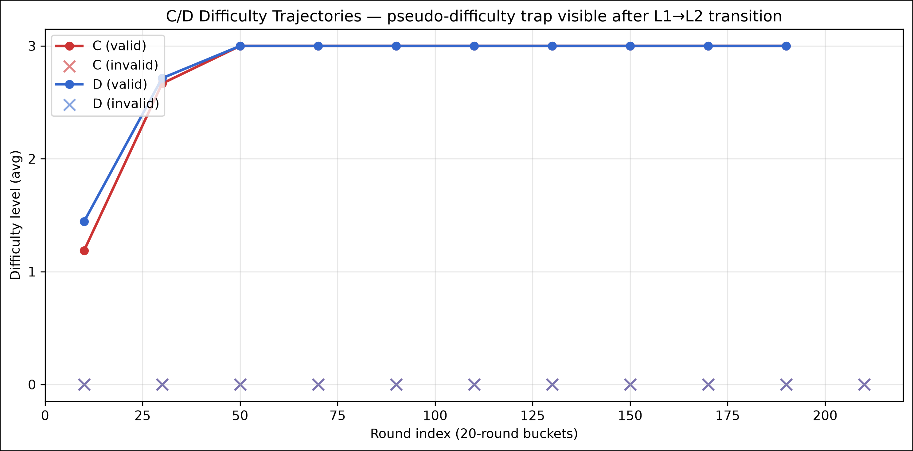

*fig4 — C/D 的难度升级轨迹：失效与升级时刻对齐。*

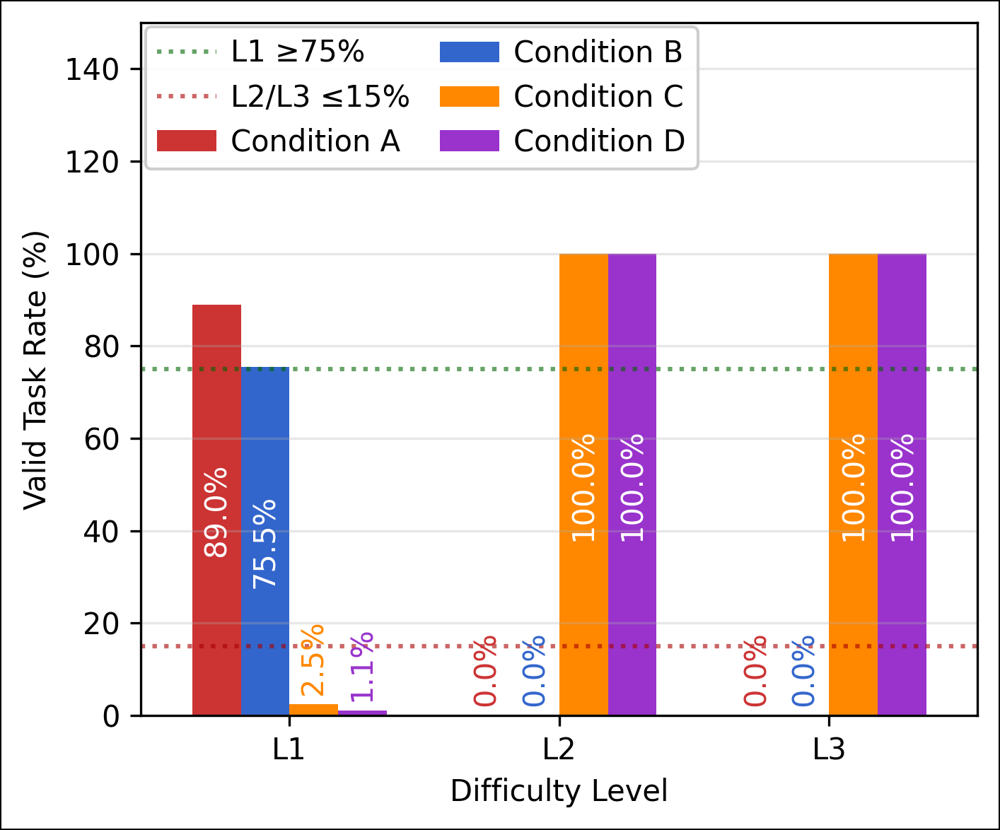

*fig3b — 按难度分级的有效任务率。注意读法：无效轮次不会被分配难度等级，因此 L2/L3 的有效率在构造上就是 100%，该口径本身**不能**证明"L2/L3 很难"——所以要配着 fig3 和 `Table 3` 一起看。真正说明问题的是整体 invalid 率（C 85.5%、D 90.5%，而 A 仅 11.0%、B 24.5%）。*

## 项目背景

我做了几年 AI 工程，一直在跟"怎么判断模型这次做对了"这件事打交道。早期靠人工标注，后来换成 LLM 当裁判，再后来上单元测试和形式验证器——每一步都在减少人工，但每一步也把一个新的不可靠环节塞进了闭环。

真正让我想认真量化这件事的，是自进化 / 自我改进这一类框架。它们的反馈信号往往就来自一个自动裁判，而这个裁判本身有错判率。直觉上错判会被下一轮的学习放大：明明做错了却被判对，这条经验会被当成正样本写进记忆；明明做对了却被判错，正确的解法反而被淘汰。于是系统不是越跑越好，而是越跑越自信地跑偏。但"跑到什么程度会崩"一直只有定性说法，没有一条能拿来直接设计系统的线。

所以我搭了 ARGUS (the internal codename) 这个五层自进化智能体，把裁判的可靠度做成一个可以拧的旋钮 τ，扫了一遍 τ 的梯度，想回答一个很具体的问题：**τ 掉到多少，这套自我改进的闭环就失效了？** 答案有闭式，而且比预想的干净——Δ_t 只跟 τ 的平方有关，跟具体开了哪些机制无关。这是整个仓库里我自己觉得最有意思的一点。

> 下面是从这里开始的完整技术内容：结论、复现步骤、数据说明、架构、设计决策与已知局限。

---

## 1. 主要结论

### 1.1 双重瓶颈合成律

一轮"成功"需要两件事同时成立：教师产出可解任务（生成侧），学生判对（裁判侧）。
按概率链式法则：

```
1 − Δ_t_global = (1 − Δ_t_gen) × (1 − Δ_t_valid)
```

该式在 2400 轮四条件数据上成立到**机器精度（1.11e-16）**。
两个瓶颈**共享同一个 Δ_t 预算** —— 这是双重瓶颈框架的定量形式。
等价于乘形式：1 − Δ_t^global = (1 − Δ_t^gen)(1 − Δ_t^valid)。

[`Table 4c`](reports/paper_data_final/tables/table4c_dual_bottleneck_law.md) 同时给出逐条件核对和由此得到的**设计规则**：留给裁判噪声的额度是 Δ_judge = 1 − (1 − Δ_t^max)/(1 − Δ_t^gen)；在 Δ_t^max = 0.60 下，条件 B（Δ_t^gen = 0.245）只需要 τ_c ≈ 0.24，而 C/D 因为生成侧一个人就吃穿预算，**在任何裁判可靠度下都不可达**。

### 1.2 裁判噪声的解析形式

设单次判决翻转概率 p = (1−τ)/2。每轮有**两次独立判决**（教师任务验证 + 学生答案验证），
一轮判对当且仅当两次判决一致：

```
P(correct) = (1−p)² + p² = (1+τ²)/2
⟹  Δ_t(τ) = (1 − τ²)/2          ← 无自由参数
```

反推设计公式：

```
τ_c = √(1 − 2·Δ_t_max)
```

实测拟合 **MAE = 0.026（条件 B）/ 0.052（条件 D）**。
判别性检验：实测 `correct_rate` 支持本模型（MAE 0.039），
排除"裁判判断 + 系统接受"模型（MAE 0.229）。

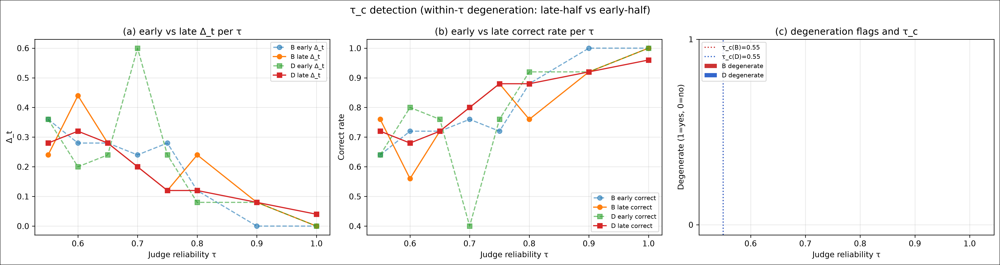

*fig5 — τ 扫描（8 个 τ × 2 条件 × 50 轮 = 800 轮真实 API，难度钉死在 L1）。面板 (c) 是退化指示量：8 个 τ 上均为 0，即没有任何 τ 触发退化判据。*

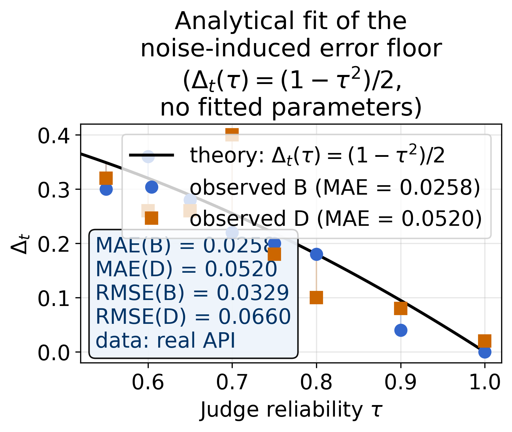

*fig5b — 闭式与实测逐格均值的对照；`Table 4b` 给出逐 τ 的数值与带符号残差。这个式子是从"每轮两次独立判决"推出来的，不是拟合出来的。*

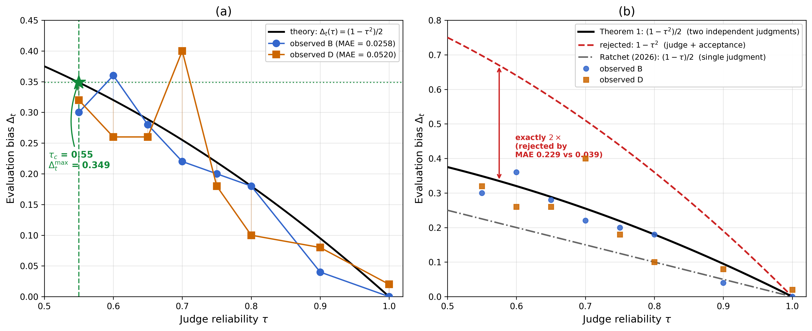

*fig5c — 一个同样能产生 τ² 形状的竞争模型（"裁判以概率 τ 判对，系统再以概率 τ 接受"，即 Δ_t = 1 − τ²）被数据否掉：MAE 0.229 对 0.039，且不需要任何拟合。*

还有一个假设**没有被支持**，我照实写在论文里：早先的估计给出 τ_c(D) = 0.90、τ_c(B) = 0.55，即"D 的种群博弈要付出裁判可靠度的代价"。在 L1 隔离下两个条件都是 0.55，这个差距不复现（`Table 4`）。

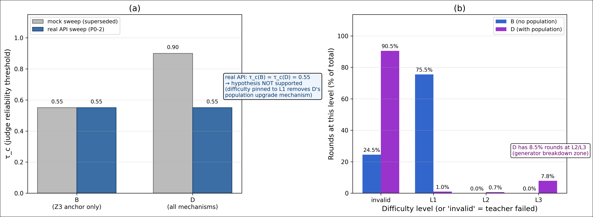

*fig7 — 左图把先导估计与实测的 τ_c 并置，右图比较 B 与 D 的难度分布。*

### 1.3 约束生成框架的效果

把"LLM 自由生成 Z3 代码"换成四层约束管线
（JSON 骨架 → 确定性渲染 → 符号反馈 → 课程控制）后，
真实 API 下有效任务率：**L1 100.0%（80/80）/ L2 73.8%（59/80）/ L3 83.8%（67/80）**
（基线在 2400 轮内只产出 11 个有效 L2 与 114 个有效 L3 任务——旧教师其实从未真正跑通 L2/L3）。

34 个无效轮次全部出自模型侧：33 个是 `error_code=1: LLM did not return valid JSON`，
1 个是不支持的变量类型；没有一个是框架自身造成的。正因如此，这组比率衡量的是**生成器能力**，
而不是工具链的可靠性。

生成器瓶颈真正绑定的地方效果很大：global 口径下 C 从 Δ_t = 0.8823 降到 0.1500
（Welch t = 15.26，Cohen's d = 2.46），D 从 0.9050 降到 0.1333（t = 16.83，d = 2.59）。
唯一口径可比的 L1 上，改进后 Δ_t = 0.000 对基线 0.082（t = 34.61，p < 1e-15，d = 1.13）。

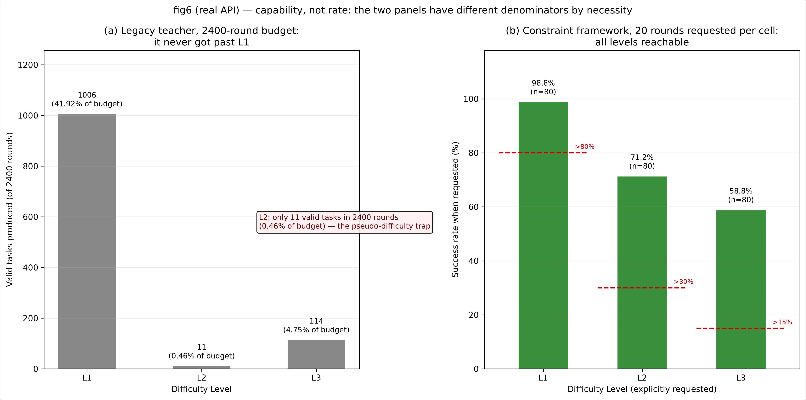

逐格数据、口径注意事项与失败归因见
[`reports/improvement_validation_real.md`](reports/improvement_validation_real.md)。

---

## 2. 复现步骤

### 2.1 安装

```bash
python -m venv .venv
source .venv/bin/activate        # Windows: .venv\Scripts\activate
pip install -r requirements.txt
```

### 2.2 单元测试

```bash
pytest tests/ -q
# 172 passed
```

### 2.3 完整图表与数据

全部 12 张图 + 9 张数据表在 [docs/gallery.md](docs/gallery.md)。

中文注记版的 12 张图在 [`paper/figures_zh/`](paper/figures_zh/) —— 与英文版一一对应、
长宽比一致（差异 <2%），供中文版论文使用；生成方式与复现命令见该目录的 README。

**9 张数据表**都在 [`reports/paper_data_final/tables/`](reports/paper_data_final/tables/)，
由 `scripts/unify_paper_outputs.py` 从原始日志重算（不调用 API）：

| 表 | 内容 |
|---|---|
| [`table1_experiment_setup.md`](reports/paper_data_final/tables/table1_experiment_setup.md) | 模型、条件、轮数、预算 |
| [`table2a_delta_t_global.md`](reports/paper_data_final/tables/table2a_delta_t_global.md) | 全局口径 Δ_t（无效轮记 1.0） |
| [`table2b_delta_t_valid_only.md`](reports/paper_data_final/tables/table2b_delta_t_valid_only.md) | 仅有效轮口径 Δ_t |
| [`table2c_delta_t_semantics.md`](reports/paper_data_final/tables/table2c_delta_t_semantics.md) | Δ_t 的统一定义，以及 2a 与 2b 为何不同 |
| [`table3_validity_rate.md`](reports/paper_data_final/tables/table3_validity_rate.md) | 各条件的有效 / 无效数与比率 |
| [`table4_tau_c_results.md`](reports/paper_data_final/tables/table4_tau_c_results.md) | 三种口径下的 τ_c（真实 API） |
| [`table4b_analytical_fit.md`](reports/paper_data_final/tables/table4b_analytical_fit.md) | Δ_t(τ)：逐 τ 的理论值与实测值、带符号残差 |
| [`table4c_dual_bottleneck_law.md`](reports/paper_data_final/tables/table4c_dual_bottleneck_law.md) | 合成律核对 + Δ_t^max = 0.60 / 0.70 / 0.80 的预算分解 |
| [`table5_improvement.md`](reports/paper_data_final/tables/table5_improvement.md) | 约束框架：各级别有效任务率（真实 API） |

### 2.4 离线复现全部图表（**不需要 API key**）

仓库内已包含论文使用的原始日志，以下命令直接读取它们并生成所有图表与数据表：

```bash
# 全量实验编排入口（查看参数）
python scripts/run_full_experiment.py --help

# Δ_t 双口径重分析 → table2b, table2c, fig2b
python scripts/reanalyze_delta_t.py

# Δ_t(τ) 解析拟合 → table4b, fig5b
python scripts/analytical_fit_tau.py

# 双重瓶颈合成律 → table4c
python scripts/dual_bottleneck_law.py

# τ_c 检测 → tau_c_analysis_real.md / tau_c_real.json / fig5_tau_c_curve_real.png
# （默认已指向 logs/tau_sweep_real/ 的真实 P0-2 sweep；--raw_root 自动取 summary 所在目录）
python scripts/detect_tau_c.py --within-tau

# τ_c 反直觉现象分析 → tau_c_gap_analysis.md, fig7
python scripts/analyze_tau_c_gap.py

# L1 阶段曲线与分级有效任务率 → fig2c, fig3b
python scripts/plot_per_round_delta_t.py

# 汇总为论文数据包 → reports/paper_data_final/ + paper_ready_final.md
python scripts/unify_paper_outputs.py
```

### 2.5 重跑实验（**需要 API key 与预算**）

```bash
export DEEPSEEK_API_KEY="<your-api-key>"   # Windows: $env:DEEPSEEK_API_KEY="<your-api-key>"

# τ 梯度扫描：800 轮，实测约 2.8 元 / 24 分钟
python scripts/run_tau_sweep_real.py \
    --tau_values 0.55,0.60,0.65,0.70,0.75,0.80,0.90,1.00 \
    --conditions B,D --rounds 50 --level 1 --use-real-api --cost-limit 10

# 约束框架验证：240 轮，实测约 1.9 元 / 46 分钟
python scripts/run_improved_smoke_real.py \
    --rounds_per_level 20 --levels 1,2,3 --conditions A,B,C,D \
    --use-real-api --cost-limit 10
```

> 重跑默认写入 `argus-workspace/_runtime/`（已在 `.gitignore` 中），
> **不会覆盖** `argus-workspace/` 与 `logs/` 下已发布的论文数据。

---

## 3. 数据说明

仓库中的数据按「论文哪一节用到」组织：

| 目录 | 内容 | 轮数 | 对应论文章节 |
|------|------|------|-------------|
| `argus-workspace/full/logs/` | 4 条件 × 200 轮 × 3 次基线实验 | 2,400 | **Section 4**（双重瓶颈证据） |
| `logs/tau_sweep_real/` | 8 个 τ 值 × 2 条件 × 50 轮 | 800 | **Section 5**（τ 梯度与解析公式） |
| `argus-workspace/improved_real/logs/` | 4 条件 × 3 难度 × 20 轮框架验证 | 240 | **Section 6**（约束生成框架） |
| `argus-workspace/improved_real_run1_hexbug/logs/` | 第一代校验器缺陷复现证据 | 49 | `reports/improvement_validation_real.md` §6 |
| `argus-workspace/improved_real_v1_lexbug/logs/` | 第二代校验器缺陷（中间态）| 240 | `reports/improvement_validation_real.md` §6 |
| `argus-workspace/smoke_real/logs/` | 早期冒烟测试 | 80 | 开发过程记录 |

两组修复前的日志保留入库，是因为改进报告写明了它们产生的中间比率、并明确称其为下界而非结果；
把来源日志一并发布，这个说法才是可核查的，而不是只能选择相信。论文本身只报告最终的实测比率。

每个 `round_*.jsonl` 是该轮的事件流（`task_generated` / `solution_verified` /
`invalid_task` 等），可直接用 `jq` 或 Python 逐轮读取。

**产出物**（`reports/`）：

| 文件 | 说明 |
|------|------|
| `paper_ready_final.md` | 论文 Section 4/5/6 初稿 |
| `paper_data_final/` | 发布包：12 张图 + 9 张表（300 DPI，英文标签） |
| `table*.md` | 各项统计表（Δ_t 双口径、τ_c、解析拟合、合成律、改进对比） |
| `fig*.png` | 论文图 |
| `data_consistency_report.md` | 4 项数据一致性交叉验证（全部 PASS） |
| `verification_v2.md` | 验证报告，含一个只在真实 API 下暴露的缺陷复盘 |
| `cleanup_report_v2.md` | 仓库清理记录 |

---

## 4. 仓库结构

```
dual-bottleneck-agents/
├── argus/                    # 核心代码（L0–L5 共 20 模块）
│   ├── llm_client.py         #   API 客户端（Mock + Real，缓存/熔断/退避）
│   ├── z3_runner.py          #   Z3 沙箱 + JSON→Z3 确定性渲染器
│   ├── z3_anchor.py          #   Z3 形式锚定 + τ 噪声注入
│   ├── agents.py             #   Teacher（JSON 骨架）/ Student
│   ├── population.py         #   种群博弈 + 能力边界检测
│   ├── constitution.py       #   12 核心规则
│   └── ...
├── scripts/                  # 实验与复现脚本（19 个）
│   ├── run_tau_sweep_real.py         # 800 轮 τ 扫描
│   ├── run_improved_smoke_real.py    # 240 轮框架验证
│   ├── run_full_experiment.py        # 2400 轮编排（断点续跑 + 成本监控）
│   ├── detect_tau_c.py               # τ_c 检测（双口径 + 显著性护栏）
│   ├── analytical_fit_tau.py         # Δ_t(τ) 解析拟合
│   ├── dual_bottleneck_law.py        # 双重瓶颈合成律
│   ├── unify_paper_outputs.py        # 论文数据包汇总
│   └── difficulty_controller.py      # 课程控制器
├── tests/                    # 172 个单元/集成测试
├── argus-workspace/          # 实验数据（论文用，随仓库发布）
├── logs/                     # 实验数据（Section 5）
├── reports/                  # 图表、数据表、报告
├── docs/                     # 公开文档（图库 + 架构说明）
├── constitution/             # 12 核心规则 JSON
├── config.yaml.example       # 配置模板
├── requirements.txt
├── DEPRECATED.md             # 可能过时但暂留的文件清单
├── README.md                 # 英文主版
└── README_zh.md              # 中文版（本文件）
```

> 开发期的设计文档与任务规格（`文档/`、`需求文档/`）属于开发内部资料，**未随仓库发布**，
> 因此不出现在上表中。它们仍保留在作者本地，论文写作会继续参考。

> **关于名字**：`argus/` 是本项目早期开发阶段给这套智能体的内部代号
> （**A**utonomous **R**ecursive **G**enerative **U**niversal **S**cientist），
> 作为 Python 包名保留，以免破坏 import 路径和已发布数据里的目录引用。
> **对外名称统一为 `dual-bottleneck-agents`**。同理 `argus-workspace/` 是运行期工作区路径，不承担命名含义。

---

## 5. 架构

| 层 | 模块 | 文件 | 职责 |
|----|------|------|------|
| **L0 基座** | API Client | `argus/llm_client.py` | Mock+Real 双模式 + 缓存/熔断/退避 |
| | Z3 沙箱 | `argus/z3_runner.py` | 持久 worker + JSON 渲染 + 危险导入拦截 |
| **L1 记忆** | ExperienceStore | `argus/experience_store.py` | SQLite + Jaccard 去重 |
| | AntibodyStore | `argus/antibody.py` | FTS5 检索 |
| | MethylationStore | `argus/methylation.py` | JSON + 半衰期衰减 |
| **L2 执行** | TaskAgent | `argus/agents.py` | Teacher（JSON 骨架）+ Student |
| | ApoptosisManager | `argus/apoptosis.py` | 熵崩溃 + 性能下降检测 |
| **L3 评测** | Z3Anchor | `argus/z3_anchor.py` | 形式锚定 + τ 噪声注入 |
| | RoundTable | `argus/roundtable.py` | 4 角色盲评 + 置信度加权 |
| **L4 进化** | PopulationGame | `argus/population.py` | 难度自适应 + 能力边界 |
| | MetaMutator | `argus/meta_mutate.py` | 宪法检查 + 停滞触发 |
| | CurriculumController | `scripts/difficulty_controller.py` | 子级别升降级 |
| **L5 治理** | Constitution | `argus/constitution.py` | 12 核心规则 |
| | CheckpointManager | `argus/checkpoint.py` | 快照 + 回滚 |
| | CostMonitor | `argus/cost_monitor.py` | 成本硬上限 |

**四条件设计**：A = 无锚定无种群；B = 仅 Z3 锚定；C = 仅种群博弈；D = 全开。

> 完整架构说明见 [`docs/architecture.html`](docs/architecture.html)（浏览器直接打开），
> 内含 **「设计蓝图 vs 实际实现」对照表**，以及初版设计里规划了但**没有落地**的功能清单。

---

## 6. 关键设计决策

| 编号 | 决策 | 原因 |
|------|------|------|
| ADR-001 | Z3 沙箱用持久 worker 池 | Windows spawn 冷启 150 ms+，持久池 warm 9 ms |
| ADR-002 | 成本计算 `call_cost_cny()` 单一函数 | 避免账本/监控分叉 |
| ADR-003 | 输入 token 硬上限 5000 | 防止 prompt 失控 |
| ADR-004 | 缓存 key 含 model+temperature+max_tokens | 否则实验泛化无效 |
| ADR-005 | max_tokens 按任务类型配置 | teacher=4000, student=3000 等 |
| ADR-006 | max_retries=5 | LLM 偶发错误需要恢复空间 |
| ADR-007 | invalid 必须写日志 | 修复静默失败 |
| ADR-008 | 难度升级需连续 5 轮成功 | 防止 L1→L2 过激跃迁 |
| ADR-009 | 模型名用 `deepseek-flash` | 实际 API 不支持 `deepseek-v4-flash` 别名 |
| ADR-010 | 成本按**累计值做差**得单轮增量 | runner 返回累计值，直接求和会虚高 N/2 倍 |
| ADR-011 | 数字字面量先占位再扫标识符 | 否则 `0x0F` 被切成 `x0F`，误判为未声明变量 |

---

## 7. 关键性能指标

| 指标 | 值 |
|------|-----|
| Z3 验证延迟 | warm 9.4 ms（首次 170 ms worker 冷启） |
| τ 扫描（800 轮） | 2.82 元 / 24 分钟 |
| 框架验证（240 轮） | 1.86 元 / 46 分钟 |
| 单轮成本 | 0.003–0.006 元/轮 |
| 缓存命中率 | 条件 B 100%（跨 τ 复用），条件 D 55–97% |

---

## 8. 已知局限

1. **Z3 沙箱是黑名单方案**，不是白名单 —— 见 `argus/z3_runner.py` 顶部"安全模型与已知局限"
2. **τ 扫描的难度钉定在 L1**，D 条件的种群升级机制因此被禁用；
   这使 τ_c(D) = τ_c(B)，原假设未被支持（见 `reports/paper_ready_final.md` §5.8）
3. **约束框架验证只有 240 轮**（4 条件 × 3 难度 × 20 轮），是能力探针而非 2400 轮的完整复现
4. **首轮真实 API 运行的 22 个失败中，16 个是十六进制字面量（`0x0F`）护栏缺陷、6 个是 `LLM did not return valid JSON`** ——
   前者是我们自己的 bug（已修复），后者才是真实能力边界；框架能保证合法骨架被正确渲染，但无法保证模型产出合法骨架
5. **Mock 与真实 API 行为差异大** —— mock 无法暴露框架缺陷
   （`0x0F` 字面量缺陷即为实例，见 `reports/verification_v2.md` §3.5）

---

## 引用

如果这项工作对你有帮助，请引用：

    @article{dual_bottleneck_2026,
      title  = {The Dual Bottleneck: A Composition Law for Judge Reliability
                and Generator Capability in Self-Evolving Agents},
      author = {李浩},
      year   = {2026},
      note   = {Code available at github.com/arnoldli001/dual-bottleneck-agents}
    }

---

## 9. 许可

MIT — 见 [LICENSE](LICENSE)。
