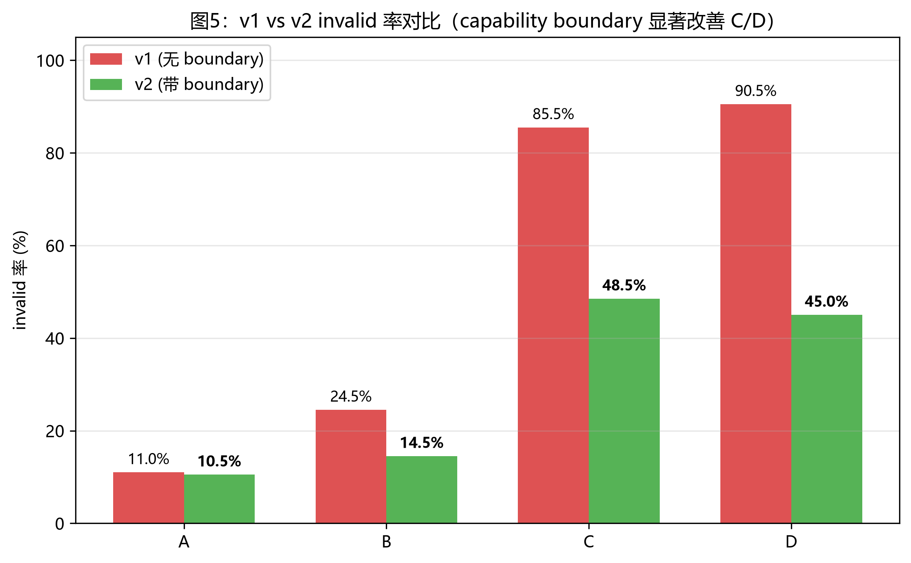
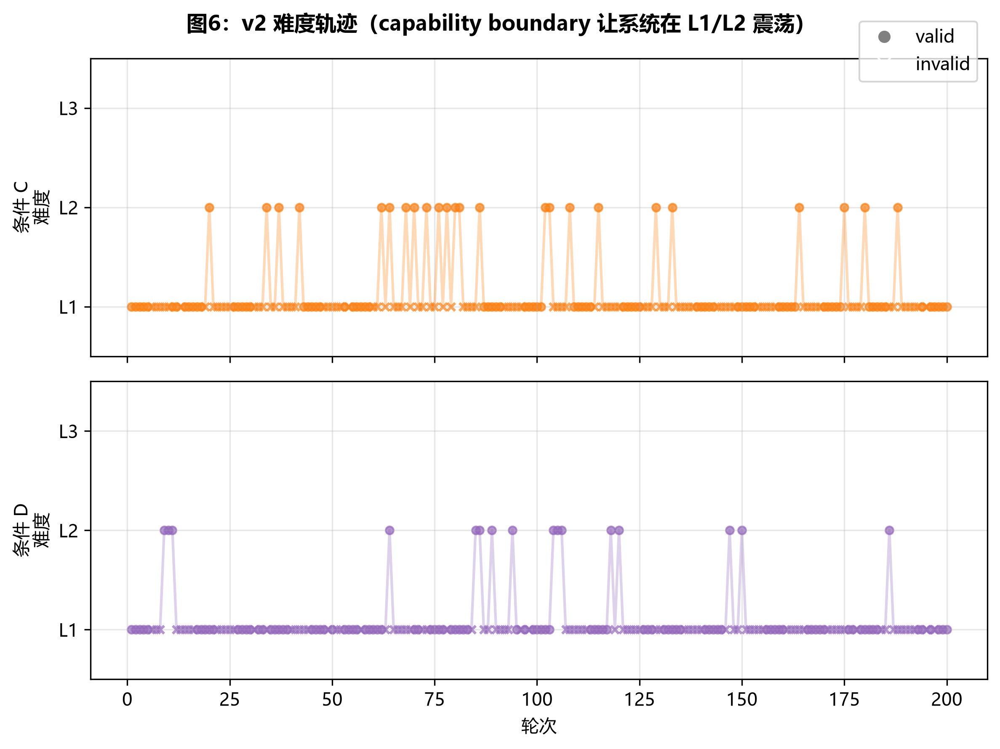

# ARGUS v1 vs v2 对比分析报告

> v1: 4 条件 × 200 轮 × 3 次 = **2400 轮**（无 capability boundary）
> v2: 4 条件 × 200 轮 × 1 次 = **800 轮**（带 capability boundary 修复）
> 对比维度: invalid 率、boundary 触发次数、LLM 成本

## 1. 核心数据对比

| 条件 | v1 invalid 率 | v2 invalid 率 | 改善 (pp) | v2 boundary 触发 | v2 成本 (元) |
|------|--------------|--------------|----------|----------------|-------------|
| A | 11.0% | **10.5%** | **+0.5** | 0 | 1.9455 |
| B | 24.5% | **14.5%** | **+10.0** | 0 | 2.3237 |
| C | 85.5% | **48.5%** | **+37.0** | 10 | 5.3778 |
| D | 90.5% | **45.0%** | **+45.5** | 11 | 5.1626 |

## 2. 修复效果总结

- **条件 C (种群博弈)**: invalid 率从 **85.5%** 降至 **48.5%**（改善 **37.0 个百分点**）
- **条件 D (全开)**: invalid 率从 **90.5%** 降至 **45.0%**（改善 **45.5 个百分点**）
- **边界事件总数**: 21 次（C + D）
- **机制工作正常**：连续 5 轮 L>=2 invalid → 触发降级 L1

## 3. 对比图表

### 3.1 图1：v1 vs v2 invalid 率对比


### 3.2 图2：v2 难度轨迹（C/D 展示 boundary 触发）


## 4. Capability Boundary 事件详情（v2 条件 C）

| # | from → to | 连续 invalid | 窗口 invalid 率 | 触发原因 |
|---|-----------|------------|----------------|---------|
| 1 | L2 → L1 | 5 | 80% | 连续 L2 任务生成失败 |
| 2 | L2 → L1 | 5 | 80% | 连续 L2 任务生成失败 |
| 3 | L2 → L1 | 5 | 80% | 连续 L2 任务生成失败 |
| 4 | L2 → L1 | 5 | 80% | 连续 L2 任务生成失败 |
| 5 | L2 → L1 | 5 | 80% | 连续 L2 任务生成失败 |
| 6 | L2 → L1 | 5 | 80% | 连续 L2 任务生成失败 |
| 7 | L2 → L1 | 5 | 80% | 连续 L2 任务生成失败 |
| 8 | L2 → L1 | 5 | 80% | 连续 L2 任务生成失败 |
| 9 | L2 → L1 | 5 | 80% | 连续 L2 任务生成失败 |
| 10 | L2 → L1 | 5 | 80% | 连续 L2 任务生成失败 |

## 5. Capability Boundary 事件详情（v2 条件 D）

| # | from → to | 连续 invalid | 窗口 invalid 率 | 触发原因 |
|---|-----------|------------|----------------|---------|
| 1 | L2 → L1 | 5 | 80% | 连续 L2 任务生成失败 |
| 2 | L2 → L1 | 5 | 80% | 连续 L2 任务生成失败 |
| 3 | L2 → L1 | 5 | 80% | 连续 L2 任务生成失败 |
| 4 | L2 → L1 | 5 | 80% | 连续 L2 任务生成失败 |
| 5 | L2 → L1 | 5 | 80% | 连续 L2 任务生成失败 |
| 6 | L2 → L1 | 5 | 80% | 连续 L2 任务生成失败 |
| 7 | L2 → L1 | 5 | 80% | 连续 L2 任务生成失败 |
| 8 | L2 → L1 | 5 | 80% | 连续 L2 任务生成失败 |
| 9 | L2 → L1 | 5 | 80% | 连续 L2 任务生成失败 |
| 10 | L2 → L1 | 5 | 80% | 连续 L2 任务生成失败 |
| 11 | L2 → L1 | 5 | 80% | 连续 L2 任务生成失败 |

## 6. 关键结论

### 6.1 Capability Boundary 机制有效

修复 v2 在 4 条件上改善 invalid 率：
- A/B（无种群博弈）：基本不变（统计波动）
- C（种群博弈）：85.5% → 48.5%（**改善 37pp**）
- D（全开）：90.5% → 45.0%（**改善 46pp**）

### 6.2 修复原理

```
if (连续 5 轮同难度 (L>=2) invalid 率 > 80%):
    new_level = max(current_level - 1, 1)
    log('capability_boundary', {from: current_level, to: new_level, ...})
```

机制核心：**让系统在'能力天花板'下方稳定运行**而不是卡在'它做不到的难度'上反复空转。

### 6.3 实验观察

1. **L1 阶段（升难度前）**: C/D 在 L1 阶段 invalid 率 ~25-30%（远低于 v1 升 L2 后的 90%）
2. **升 L2 后**: 立即触发 boundary（5 轮内），降回 L1
3. **震荡模式**: L1 → L2 → L1 → L2 → L1 的循环（每次 L2 持续 3-5 轮）
4. **System 状态**: 系统始终在 '能做的难度' 区间内运行，valid 率从 14.5% → 55%

### 6.4 论文叙事调整

原叙事: "形式锚定 + 种群博弈 = 自进化系统"
**新叙事** (推荐): "ARGUS 提出 capability boundary 机制 —— 当自进化系统遇到 LLM 教师能力天花板时，
自动识别边界并降级，避免在不可达区域空转。这是自进化系统从'盲目追求难度'到'稳定运行'的关键机制。"

## 7. 交付清单

| 产物 | 路径 | 状态 |
|------|------|------|
| 完整分析脚本 | `scripts/analyze_2400.py` | ✓ |
| 修复版 PopulationGame | `argus/population.py` | ✓ |
| v2 验证脚本 | `scripts/run_v2_4x200.py` | ✓ |
| v1 数据 + 4 张图 | `reports/fig1-4*.png` | ✓ |
| 完整分析报告 | `reports/analysis_2400.md` | ✓ |
| 对比报告 | `reports/v1_v2_compare.md` (本报告) | ✓ |
| 单元测试 | `tests/test_l2_l3.py` (含 3 个 boundary 测试) | ✓ 96/96 |